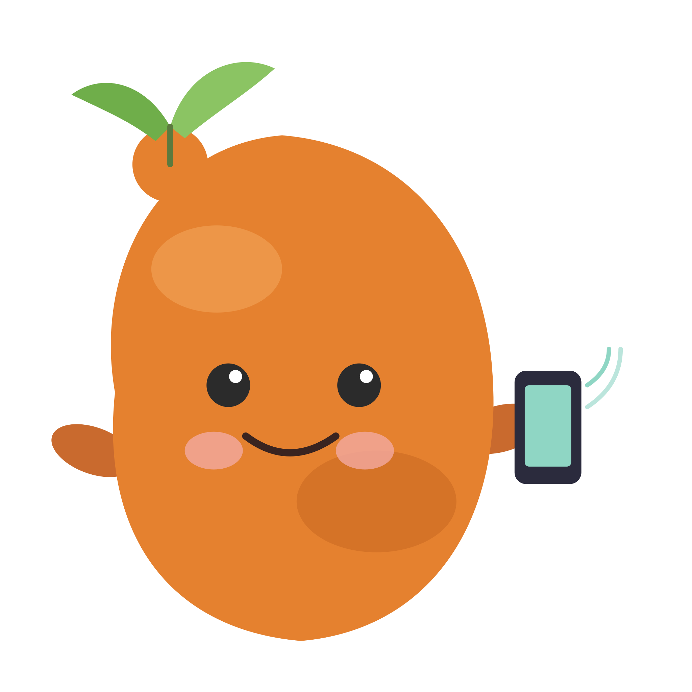

<p align="center">
  
</p>

<h1 align="center">YAM — Your Adventure Mobile</h1>
<p align="center"><em>Your MUSH. Your MUD. Your pocket.</em></p>

---

YAM is a MUSH/MUD client for Android — for the nights you can't get to a
desktop but the comsys absolutely will not stop buzzing.

```
> connecting to duskhaven.mush.org:4201...
> connected.

The Sagging Tavern
The ale is flat, the fire is low, and someone at the bar is
definitely rolling dice under the table.
Obvious exits: north, out.

Thoran pages: "you alive over there or nah"

>
```

## What it actually does

- **Real telnet, not a toy** — full connection handling with proper reconnects, because "the client dropped" is not a valid IC excuse.
- **Full ANSI color** — your world's blood spatter, forest canopy, and passive-aggressive OOC channel all render exactly as intended.
- **Per-world profiles** — keep your mild-mannered alt and your unhinged admin account in two entirely separate, non-overlapping lives.
- **Triggers & aliases** — for the players who automate what everyone else does by hand, and are not sorry about it.
- **Session logging** — for receipts, when someone insists they definitely did not say that in scene three.
- **Built for a phone screen** — not a desktop client squeezed down, designed mobile-first, for thumbs, not a mouse.

## Who I made this for

- People who still remember their very first `@desc`, typos and all
- Anyone with strong, unresolved opinions about ANSI color codes
- Players who have paged the wrong person at the worst possible moment
- Anyone who has typed "brb, IRL emergency" and meant it as a complete sentence
- People who have tried, and failed, to explain what a MUSH is to a coworker

Mostly, though — this is for the people who never actually stopped logging
in. You just started doing it from the couch, the bus, or the back of a
meeting that could've been an email.

## Get YAM

*Link goes live at launch.*

## Credit where it's due

YAM is a fresh, ground-up build, but it tips its hat to *Potato*, the
desktop MUSH client by Mike Griffiths that's kept people connected to their
worlds for well over a decade. Different platform, same idea: don't lose the
thread.

---

Made by **Rick Donaldson** (aka Thoran) · MIT licensed · bugs and trigger
ideas equally welcome.
